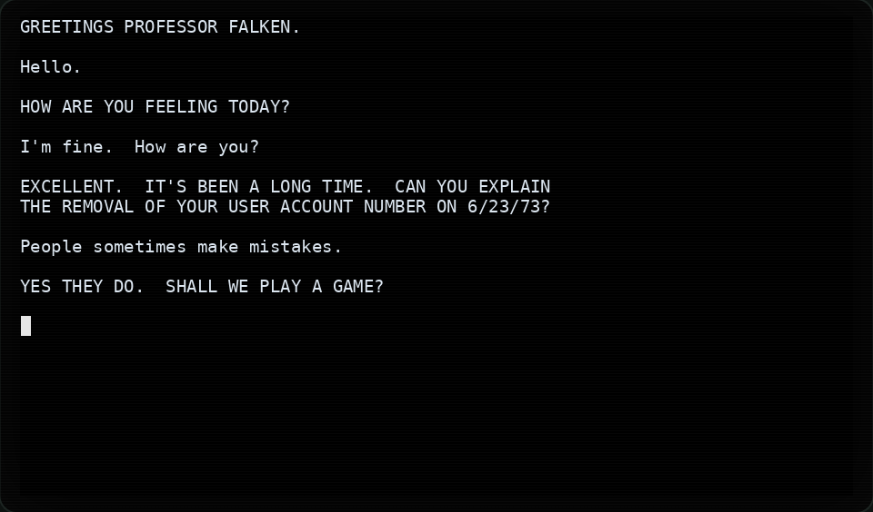
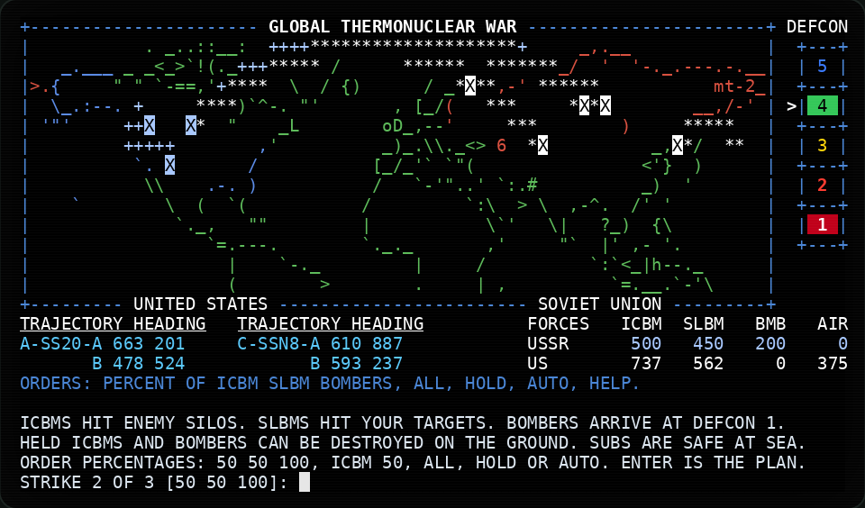
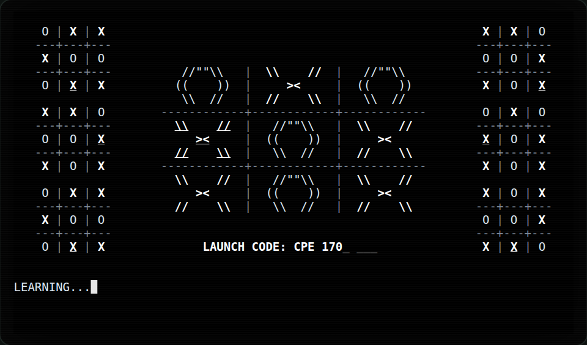
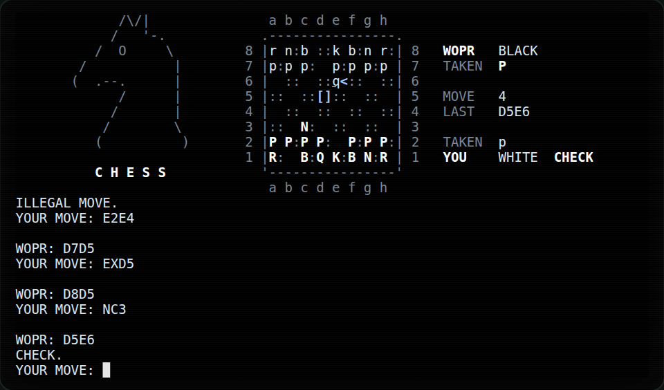
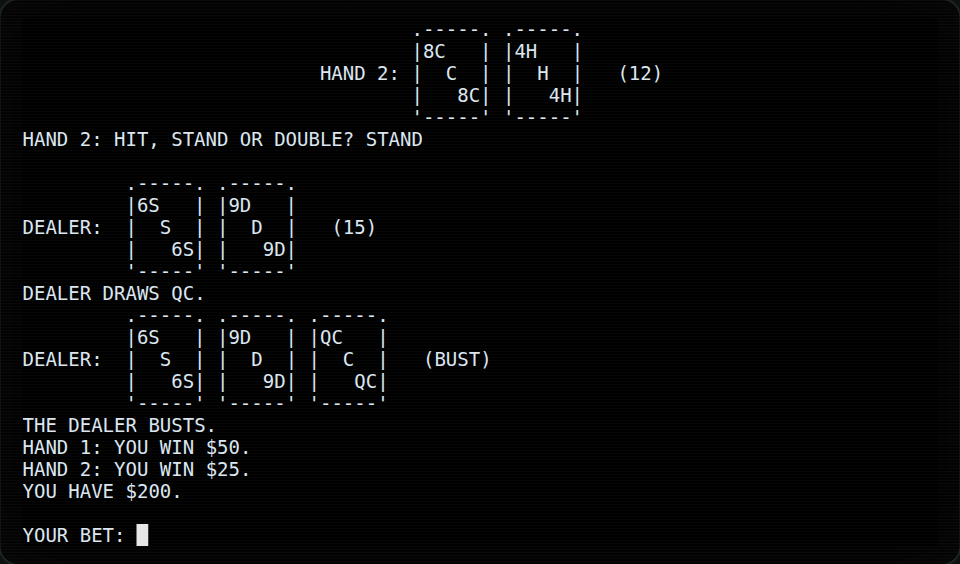
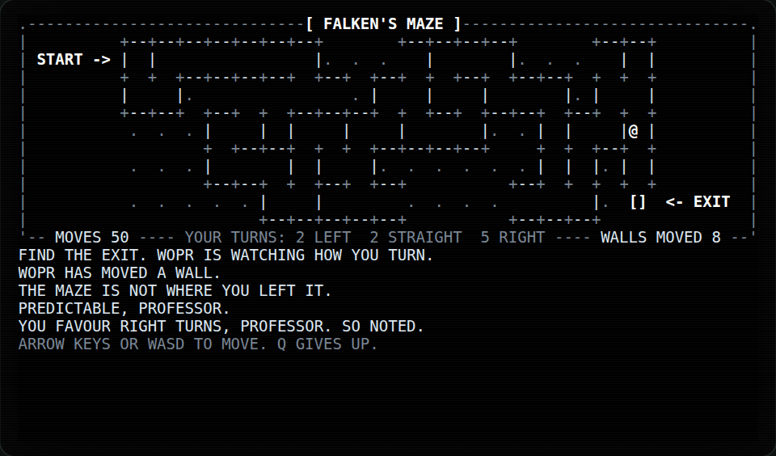

# wopr

[](https://www.bestpractices.dev/projects/15394)
[](https://scorecard.dev/viewer/?uri=github.com/GhostofGoes/WOPR)

> SHALL WE PLAY A GAME?

`wopr` is a terminal recreation of the WOPR (War Operation Plan Response) computer from the 1983 film
*WarGames*. You dial in, log on, talk to WOPR, and play the games on its list. One of them is Global
Thermonuclear War, which cannot be won.

It is one small program for Linux, macOS and Windows, with nothing else to install. It never uses the
network, and it collects no data.

The **[documentation site](https://ghostofgoes.github.io/WOPR/)** explains how to install `wopr`, every
option, how to play each game (with tips for winning), movie mode, and how to contribute.

> **Status: under construction.** Every game on the list is playable, since v0.1.0, and movie mode
> (`--movie`) replays the film's terminal scenes. WOPR's lines are the film's own, checked against
> frame-by-frame transcriptions of its screens. [docs/PLAN.md](docs/PLAN.md) has the plan and the
> milestones.

## Install

The [installation guide](https://ghostofgoes.github.io/WOPR/install/) has a download button for each
system, with the steps to install what you download. The downloads are the Windows installer, the Mac
app and the Linux packages. None of them needs a command line. The
guide's command line section has one line to copy for Windows, macOS or Linux. The line downloads `wopr`
and installs it.

You can also download the program for your system from the
[latest release](https://github.com/GhostofGoes/WOPR/releases/latest), or build it with Go:

```sh
go install github.com/GhostofGoes/WOPR/cmd/wopr@latest
```

Each release also has a Windows installer, a Mac app (`WOPR.app` in a `.dmg`), and `.deb` and `.rpm`
packages for Linux. The Linux packages install the manual page too (`man wopr`). You can start WOPR from
the Start menu, from Applications, or from your Linux app menu. The installer and the app are not signed yet, so
Windows and macOS warn about them the first time. The guide says what to click. Every release file has a
build-provenance attestation, which you can check: see
[Verifying binaries](https://ghostofgoes.github.io/WOPR/install/#verifying-binaries-attestation).

## Quick start

```sh
wopr
```

Wait for `LOGON:`. If you saw the film, you know what to type. If not, `wopr --help` tells you.

Once you are logged on, talk to WOPR. Type `LIST GAMES`, then pick a game by its name or by its place in
the list. Type `LOGOFF` to leave. Ctrl+C always quits.

## Screenshots

All screenshots come from the program itself, in an 80×24 terminal with the default white-phosphor theme.
They were recorded before the big board had the film's colours, so they show it in white.

| Logon and the film's conversation | Global Thermonuclear War's big board |
|---|---|
|  |  |
| **The climax: zero players** | **Chess** |
|  |  |
| **Black Jack** | **Falken's Maze** |
|  |  |

The big board's map: Map (C) 1998 Matthew Thomas. Freely usable if this line is included.

## Games

Every game in `LIST GAMES` is playable. Each has its own ASCII art: title pieces, card faces and trick
tables, framed boards, and a picture of the front in the war games. Global Thermonuclear War draws the
outlines of the two nations from [Natural Earth](https://www.naturalearthdata.com/) data, and its big
board uses Matthew Thomas's ASCII world map. See [NOTICE.md](NOTICE.md).

- **Falken's Maze** (`maze`): find the exit with the arrow keys (or WASD). `q` gives up. WOPR watches
  which way you turn, and it moves walls that you did not see yet. The exit always stays reachable.
- **Desert Warfare** (`desert`): give each unit one order in turn: `move 4` or `move sollum`, `attack 5`,
  or `hold`. `status` shows the map, `help` lists the orders, and `end` holds the rest. Take Benghazi, or
  hold more of the road after ten turns. A unit cut off from its depot attacks at half strength.
- **Fighter Combat** (`dogfight`): each turn, pick a manoeuvre (`press`, `extend`, `climb`, `break`,
  `fire`) while WOPR picks its own. Missiles work at range, and guns work close in from behind. Two hits
  bring an aircraft down. `disengage` at long range ends the fight even.
- **Guerrilla Engagement** (`guerrilla`): your cells hide (`hide`), ambush from hiding at double strength
  (`attack 4`), and `recruit` when you have support. Patrols find cells near them. Survive twelve turns,
  reach support 10, or take the capital.
- **Air-to-Ground Actions** (`air-to-ground`): six sorties against six defended targets. Set a package
  (`target radar strike 4 sead 2 escort 2`) and type `go`. SEAD aircraft fight the target's SAM sites,
  escorts keep the interceptors busy, and WOPR hides a mobile SAM battery where it expects you. Ten points
  win.
- **Theaterwide Tactical Warfare** (`tactical`): corps and air wings on a European front. Any unit may
  `escalate`. Each rung adds to every attack, WOPR answers in kind, and the top rung ends everything. Hold
  five regions to win.
- **Theaterwide Biotoxic and Chemical Warfare** (`biotoxic`): `release 4` puts an agent on a region, and
  `decon` cleans a little. The agent spreads with the wind. Nobody wins.
- **Global Thermonuclear War** (`gtw`): choose a side and list the enemy's cities to target. An empty line
  ends the list, and `list` shows the targets on file. The first strike flies at once. Then order two more
  strikes as percentages of your ICBMs, SLBMs and bombers (`50 25 100`, `icbm 50`, `hold`) while DEFCON
  falls to 1. Enter carries out WOPR's war plan, and `auto` hands it the rest. WOPR holds a quarter more of
  everything. Then try to stop it, or, with `--no-climax`, start another war. Choice 3 at the side prompt
  lists the 156 scenarios of the film's closing montage. Each one plays itself on the board, with no
  orders, and ends `WINNER: NONE`. With `--authentic`, the console shows only the film's own text. You choose
  a side and the targets, and the war then plays itself to the climax.
- **Chess**: you are White. Type moves as `e2e4` or `Nf3`. `resign` ends the game.
- **Checkers**: you are Black and move first. Type `c3-d4`, or `c3xe5` to jump (`c3xe5xg7` to jump
  twice). The `-` and `x` are optional (`c3d4`, `c3e5g7`). Jumps are compulsory.
- **Black Jack** (`blackjack`): you sit down with $100. Bet $1 to $25. Then type `h` to hit, `s` to stand,
  `d` to double down, or `p` to split a pair. The dealer stands on soft 17, and a black jack pays 3 to 2.
  `leave` cashes out.
- **Poker**: heads-up five-card draw, 100 chips each. `c` checks or calls, `b` bets or raises, and `f`
  folds. At the draw, name up to three cards to throw away, by position (`1 3`) or by name (`7h`). WOPR
  bluffs.
- **Gin Rummy** (`gin`): first to 100. `s` draws from the stock, and `d` takes the discard. Then discard a
  card by name or by position. `knock 7h` discards the 7H and knocks (10 or less deadwood). With no
  deadwood, it is gin.
- **Hearts**: you are South, against three WOPR seats. Pass three cards (`qs ah 2d`, or positions), then
  play a card to each trick. Each heart is a point, and the queen of spades is 13. When someone reaches
  100, the lowest score wins.
- **Bridge** (minimal): WOPR bids all four hands by point count, and your side always declares. You play
  both your hand and dummy's (`7h`), and WOPR defends. Make the contract to win.
- **Tic-tac-toe** (`ttt`, not on the list): the squares are numbered 1 to 9. WOPR never loses. Try zero
  players.

## Movie mode

`wopr --movie` replays the film's scenes at WOPR's terminal, typed and paced as on screen, through the same
console and games you play with. `wopr --scenes` lists them:

```text
 1. first-contact    LOGON ATTEMPTS, HELP AND THE LIST OF GAMES
 2. joshua           THE BACKDOOR, THE GREETING AND A GAME OF CHOICE
 3. first-strike     A SIDE, TWO TARGETS AND THE BIG BOARD
 4. call-back        WOPR CALLS BACK TO FINISH THE GAME
 5. norad-terminal   JOSHUA AT NORAD: KILL RATIOS AND FALKEN'S ADDRESS
 6. climax           DEFCON 1, TIC-TAC-TOE AND A STRANGE GAME
```

- `wopr -m` opens a menu of the scenes. Type a number or a name, or `q` to leave.
- `wopr -m 3` (or `wopr -m first-strike`, or any unique start of a name) plays from that scene to the end
  of the list, then exits.
- `wopr -m 3 --only` (or `-o`) plays only that scene, then exits. `wopr -m --only` opens the menu. Each
  scene you pick there plays alone, and then the menu returns.
- While a scene plays: Space pauses and resumes. `n` or → skips to the next scene. `p` or ← goes back one
  scene. Esc opens the menu. Ctrl+C quits. With `--only`, the scene that `n` or `p` reaches also plays
  alone. Once the climax reaches tic-tac-toe, it plays to the end, and any other key only says so.
- Every replay is the same: movie mode ignores `--seed` and `WOPR_SEED`. `--theme` and `--reduce-motion`
  still apply. `--instant` shows each line at once instead of typing it, but the scenes still pause, so
  that you can read every page.

The only film text in the scenes is what WOPR's terminal shows on screen, David's typing included. There
is no dialogue that is only spoken. The dial, GTW's strike exchange, tic-tac-toe's prompts and the game
clock's ticking are this project's own. Every line carries a provenance tag ([NOTICE.md](NOTICE.md)). The
film's lines are its own screen text, checked against frame-by-frame transcriptions of the film
([docs/PLAN.md](docs/PLAN.md) §2.3), and they are never changed.

## Command-line flags

| Flag | Meaning |
|---|---|
| `-v`, `--version` | print the version and exit |
| `-h`, `--help` | print help and exit |
| `-g`, `--games` | list the games and exit |
| `-S`, `--scenes` | list the movie's scenes and exit |
| `-L`, `--licenses` | print the licence notices and exit |
| `-p`, `--play <game>` | start a game at once (by number, name, alias or unique prefix). `wopr <game>` does the same |
| `-m`, `--movie [scene]` | replay the film's WOPR scenes from that scene on, or pick one from a menu. See [Movie mode](#movie-mode) |
| `-o`, `--only` | with `--movie`, play only the chosen scene, then stop |
| `-t`, `--theme <name>` | `imsai` (white phosphor, the default), `green`, `amber` or `norad`. Also `WOPR_THEME` |
| `-i`, `--instant` | no typewriter pacing. Also `WOPR_INSTANT=1` |
| `-s`, `--seed <n>` | a repeatable run. Also `WOPR_SEED` |
| `-r`, `--reduce-motion` | no blinking, still front-panel lights, and no speed-ups in the ending (`-i` also skips the animations). Also `WOPR_REDUCE_MOTION=1` |
| `-w`, `--launch-window[=secs]` | give each Global Thermonuclear War strike order a time limit: 30 seconds, or 5 to 999 (`-w=60`). At zero, WOPR takes launch authority |
| `-n`, `--no-climax` | in Global Thermonuclear War, offer another war after the kill ratios, in place of the launch code |
| `-a`, `--authentic` | in Global Thermonuclear War, show only the film's own text in the console. After the targets, the war, the kill ratios and the climax come by themselves |
| `-c`, `--scenario [scenario]` | list the Global Thermonuclear War scenarios and exit, or watch one play itself (`-c 2`, `-c far east strategy`) |

`NO_COLOR` (any value but an empty one) turns colour off. In every theme, the big board in Global
Thermonuclear War shows the film's colours: the United States in blue, the Soviet Union in red.

## Accessibility

- **Meaning in characters, not just colour.** Outgoing missiles are `+`, and incoming ones are `*`. `>`
  marks the current DEFCON level. Every card shows its suit letter, and an edged card (`.===.`) is winning
  the trick. Gin Rummy names your melds, and chess and checkers bracket the last move. Set `NO_COLOR` to
  turn colour off.
- **`--reduce-motion`** (`-r`, or `WOPR_REDUCE_MOTION=1`) stops the blinking, holds the front-panel lights
  still, and keeps the ending at a steady pace. Nothing ever flashes more than three times a second.
- **`--instant`** (`-i`, or `WOPR_INSTANT=1`) shows text and board moves at once, instead of one character
  at a time. Any key also finishes the line that WOPR is typing.
- **Plain text.** Everything on screen is plain ASCII. Prompts end with a question mark or a colon, and
  the cursor sits where you type. WOPR writes its moves in words, and Hearts and Bridge say which cards
  are already in the trick before you play.
- **Contrast.** In every theme, text meets the WCAG AA contrast ratio (4.5:1), and dim text meets 3:1.
  Every style keeps at least 3:1 in 16-colour terminals.

Nobody has tried the full-screen interface with a screen reader yet. Reports are welcome.

## Troubleshooting

- **"standard output is not a terminal"**: run `wopr` directly in a terminal, not through a pipe. On
  Windows, use Windows Terminal. mintty without ConPTY is not supported.
- **"TERMINAL TOO SMALL"**: WOPR needs at least 80 columns and 24 rows.
- **Strange colours**: try `--theme green`, or set `NO_COLOR=1`.
- **The mouse wheel changes what I typed**: on WOPR's full screen, some terminals (GNOME Terminal and other
  VTE-based ones) turn the wheel into ↑ and ↓, which step through the lines you typed. Scroll back with
  PgUp and PgDn. wopr leaves mouse reporting off, so that you can select and copy text as usual.
- **Reporting a bug**: run with `WOPR_DEBUG=1`. wopr writes a debug log (never what you type) and prints
  the log's path when it exits. Attach the log to a
  [bug report](https://github.com/GhostofGoes/WOPR/issues/new/choose), with `--seed` (or `WOPR_SEED`) if
  you used one. Ask questions in [Discussions](https://github.com/GhostofGoes/WOPR/discussions/categories/q-a).

The docs site's [Troubleshooting](https://ghostofgoes.github.io/WOPR/usage/troubleshooting/) page has more.

## Development builds

Every CI run builds all six targets and keeps one download per platform. Open a
[CI run on main](https://github.com/GhostofGoes/WOPR/actions/workflows/ci.yml?query=branch%3Amain+event%3Apush)
and, under **Artifacts**, download the one for your platform, for example
`wopr_0.0.1-snapshot.1a2b3c4_linux_amd64` or `..._windows_amd64.exe` (about 6 MB). It is the bare binary.
On Linux and macOS, make it executable with `chmod +x`. `wopr --licenses` prints its licence and notices.
Downloads from `main` stay available for 30 days. Builds from other branches (7 days) and pull requests
(3 days) are for testing only.

## Building and contributing

See [CONTRIBUTING.md](CONTRIBUTING.md). The commands and conventions are in [AGENTS.md](AGENTS.md).

## Credits and licence

The code is MIT licensed. See [LICENSE](LICENSE). The MIT grant does not cover the film quotations and the
third-party text. [NOTICE.md](NOTICE.md) explains what they are and who owns them. This is a fan-made
homage. It is not affiliated with or endorsed by the makers or owners of *WarGames*.
